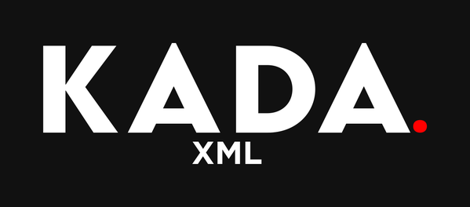

<p align="center"></p>

# KADA XML

**Premiere → Final Cut Pro X.** Premiere Pro sekanslarını Final Cut Pro X'e (FCPXML) taşıyan küçük, ücretsiz bir program.
Windows ve Mac'te çalışır, kurulum gerektirmez.

*KADA XML is a small free tool that moves Premiere Pro sequences into Final Cut Pro X (FCPXML). English below.*

## İndir

[Releases](../../releases) sayfasından:
- **Windows:** `KADA-XML-Windows.zip` → içindeki `.exe`
- **Mac:** `KADA-XML-macOS.zip` → `KADA-XML.app`
  (imzasız olduğu için ilk açılışta: sağ tık → **Aç**)

## Kullanım

1. Premiere'de sekansı seç → **File → Export → Final Cut Pro XML…**
2. Programda bu XML'i seç.
3. Medya Mac'te başka bir yerdeyse, **"Mac'teki yeri"** alanına o klasörü yaz
   (ör. `/Volumes/Disk/Dugun_Isim`). Program XML'deki ortak medya klasörünü kendisi bulur.
4. **Dönüştür**'e bas → `.fcpxml` dosyası çıkar.
5. Final Cut Pro X: **File → Import → XML…** Klipler kırmızı gelirse: seç → **File → Relink Files**.

## Ne taşınır, ne taşınmaz

| Taşınır | Taşınmaz |
|---|---|
| Kesimler, in/out noktaları (geçişe değen klipler dahil) | Efektler, Lumetri / renk |
| Track düzeni (V1 ana storyline, V2+ üstte, sesler altta) | Yazılar, MOGRT, generator (yerine marker) |
| Boşluklar (gap) | Nest içeriği (yerine boşluk + marker) |
| V1 geçişleri → Cross Dissolve (yer ve süre aynı) | V2+ üzerindeki geçişler |
| Ses geçişleri → ses fade'i | Opaklık, ölçek, pozisyon keyframe'leri |
| Klip açık/kapalı durumu | |
| Ses seviyesi, Gain, ses keyframe'leri | |
| Sabit hız, ters klip (kontrol et) | |
| Fotoğraf / PNG / JPG | |
| Karışık kare hızları (23.976, 25, 29.97, 30, 50…), drop-frame | |
| Sekans ve klip marker'ları | |
| WAV/BWF timecode (senkron) | |

Taşınmayan her şey dönüştürmeden sonra raporda yazar.

**Bilinen:** 23.976 bir sekansta 29.97 klibin hemen ardından 50p klip gelirse Final Cut
"not on an edit frame boundary" uyarısı verip bir alt klibi 1 kareden az kaydırabilir.
Geçiş için medyada yeterli kare yoksa geçiş kısaltılır ya da düz kesim olur (raporda yazar).

## Komut satırı

Python 3.8+ ile, ek paket gerekmez:

```
python premiere_to_fcpxml.py SEKANS.xml SEKANS.fcpxml --to "/Volumes/Disk/Is"
python app.py          # pencereli arayüz
python tests/test_convert.py [gercek.xml]   # öz test
```

---

## English

1. In Premiere select the sequence → **File → Export → Final Cut Pro XML…**
2. Open the XML in the app. If the media lives elsewhere on the Mac, put that folder in
   **"On the Mac"**. The app detects the common media folder in the XML and swaps it.
3. **Convert** → import the `.fcpxml` in FCPX via **File → Import → XML…**
   (relink if clips show as missing).

Carries cuts, in/out points (also for clips that touch a transition), track layout
(V1 = primary storyline, other video tracks as lanes above, audio as lanes below), gaps,
V1 transitions as Cross Dissolve, audio transitions as fades, enable state, audio level,
gain and level keyframes, constant and reversed speed, stills, mixed frame rates,
drop-frame, markers and BWF timecode for WAV files. Effects, color, titles, nests and
video keyframes are not carried; titles and nests leave a marker. Everything not carried
is listed in the report. Standard library only. MIT license.

Tests: `python tests/test_convert.py` (synthetic) and `python tests/test_fixtures.py`
(real Premiere exports in tests/fixtures, checked against Final Cut's own DTD when installed).

Builds: push a tag `v*` and GitHub Actions builds the Windows `.exe` and macOS `.app`
and attaches them to the release.

---

## İletişim / Contact

Göksel Tuzun · **Kada Film**
✉️ [gokseltuzun@gmail.com](mailto:gokseltuzun@gmail.com)

Hata, öneri ya da teşekkür için yazabilirsin. Programı işine yaradıysa bir ⭐ bırak.
*Bugs, ideas or thanks are welcome. If it saved you time, leave a ⭐.*
